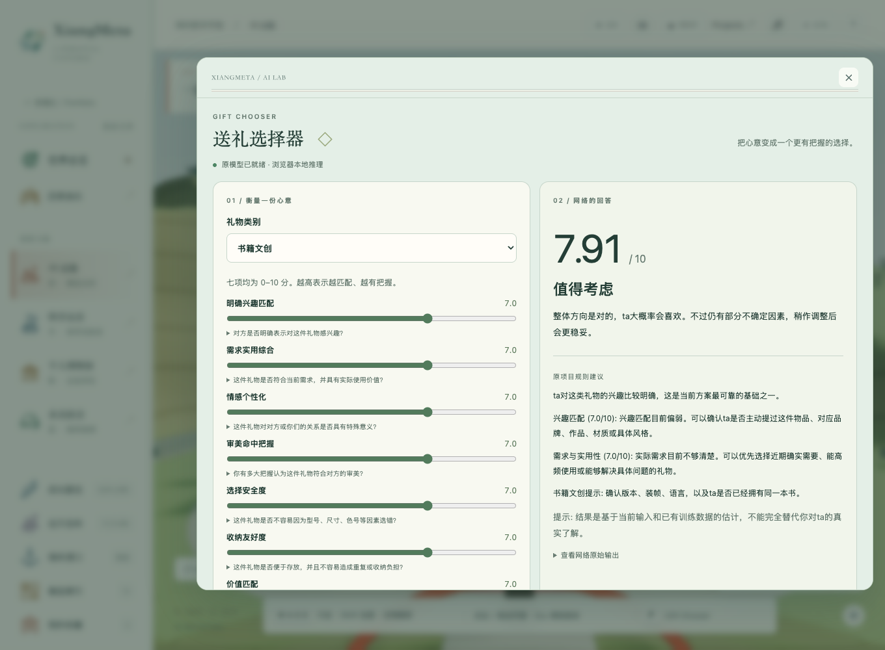
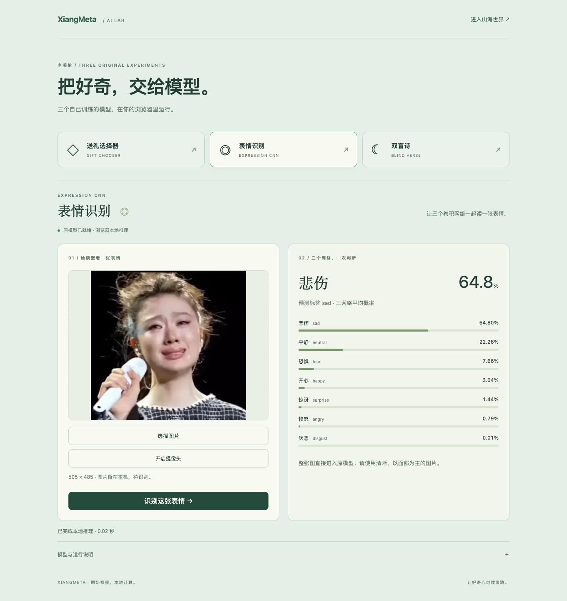

# XiangMeta AI Lab 交付与验收

三个原项目已整合为同一静态应用，复用作者的真实训练权重。独立入口与世界内小窗共享代码，推理在浏览器 Worker 内完成。以下记录可由测试脚本、模型清单和实际截图核验。

## 访问与使用

- AI Lab：<https://sherlock-lxl.github.io/ai-lab/>
- 世界：<https://sherlock-lxl.github.io/world/>
- 直达送礼：<https://sherlock-lxl.github.io/ai-lab/?project=gift-chooser>
- 直达表情：<https://sherlock-lxl.github.io/ai-lab/?project=expression-recognition-cnn>
- 直达双盲诗：<https://sherlock-lxl.github.io/ai-lab/?project=blind-verse-rnn>

独立模式通过三张入口卡切换项目。送礼选择类别并调整七个评分后计算；表情上传清晰、以面部为主的图片，或主动开启摄像头、拍摄一帧后识别；双盲诗可直接生成两句，或输入 1–3 字前缀续写，选择三档风格并收藏结果。模型状态和推理耗时是真实运行状态。

世界内进入 AI 山脉，靠近送礼、表情、诗歌展台，按 F 或点击「体验 AI」。小窗自动打开相应项目，保留当前位置与视角。点击右上角关闭或按 Esc 返回世界；输入文字时世界不移动。E 仍可查看作品简介、档案和源码。

发布地址为现有根域名的新增目录。旧 `/xiangmeta/` 路径继续停用。线上部署与实际推理结果在发布完成后记录于本文末尾。

## 原项目调查与来源

完整源码、依赖、架构、文件大小与原始 SHA256 见 [源码与模型调查](ai-lab-investigation.md)；逐文件来源与部署资源哈希见 [模型清单](../data/ai-lab-models.json)。

| 项目 | 源码版本 | 原始模型/算法 | 本次实现 |
| --- | --- | --- | --- |
| Gift Chooser | `029c186b55120073bc7d34e62bfcca8a34ade63f` | NumPy 手写 `14→8 ReLU→1`，129 参数 | 原参数 JSON、JavaScript Float64 前向计算 |
| Expression CNN | `cfd71e55f49b0df9af7ab283e648a74ff9173910` | 三个独立残差 CNN，Softmax 概率等权平均，共 1,360,341 参数 | FP32 ONNX 集成网络、ONNX Runtime Web 1.23.2 WASM |
| Blind Verse | `4abc105b799ccdc92efe769ccf555122d2396f7c`，权重 Release `v1.0.0` | 5,160 字符、E/H 1536、单层 LSTM，34,743,336 参数 | FP32 单 token ONNX、显式 h/c、自回归采样 |

Gift 不是规则系统：网络输出分数，原项目规则另外生成建议，两者在页面中明确区分。七项输入除以 10，再拼七类 one-hot；线性原值不经过 Sigmoid，展示值才裁剪并乘 10。保留原评分说明、分数段文案、类别与规则建议。

CNN 保留 Pillow 灰度化在前、抗锯齿双线性 Resize 48×48 在后、再除以 255 的顺序。浏览器实现等价像素预处理，没有改用 CSS 缩放或人脸检测。标签顺序为 `angry, disgust, fear, happy, neutral, sad, surprise`，中文仅为展示译名。

RNN 两句各从 BOS 与全新 h/c 开始，字符映射、PAD/BOS/UNK 屏蔽、EOS 结束逻辑保留。双盲最多 30 新字符；前缀 1–3 字，最多追加 20 字。三档 Temperature/Top-k 为 0.55/5、0.70/15、0.90/30。固定测试随机流用于验证采样一致性，不声称 JavaScript 种子与 PyTorch 内置 RNG 相同；日常生成使用新的随机流。

全部参数没有量化、重训练或替换。未部署训练数据。原许可证和 Gift 模型特定偏好场景的用途说明保存在 `scripts/ai-lab-originals/`，构建同时生成 `THIRD_PARTY_NOTICES.txt`。模型不代表任意人的真实偏好，表情概率也不代表准确率或心理诊断。

## 代码与静态构建

```text
ai-lab/index.html                 独立目录入口，可直接刷新
src/ai-lab/main.ts                 三种真实交互、共享导航和嵌入通信
src/ai-lab/style.css               浅绿、纸绢色二维响应式界面
src/ai-lab/modal.css               桌面/手机世界弹窗
src/ai-lab/client.ts               Worker 调用、取消与空闲释放
src/ai-lab/worker.ts               下载校验、缓存、模型初始化与推理
src/core/ai-lab-frame.ts           世界复用一个 iframe
shared/ai-lab.mjs                  项目映射、Gift 前向、CNN 像素处理、RNN 采样
shared/original-gift-ui.json       从原 App 导出的评分/规则说明
data/ai-lab-models.json            原始来源和部署资源 allowlist、SHA256
public/assets/ai-lab/              版本化原参数、ONNX 与外部权重
scripts/export-ai-lab.py           原始权重导出与 PyTorch/ONNX 对照
scripts/export-gift-ui.py          从原 UI 导出说明文案
scripts/verify-ai-lab-originals.py  核验源码与原算法/模型基线
scripts/ai-lab-originals/          冻结原始架构、App、说明与许可证
scripts/build-ai-lab.mjs           独立构建，Windows/macOS 均可用
scripts/web-content.mjs            同源 WASM、模型 allowlist 与构建哈希核验
scripts/sync-pages.mjs             同步独立 Pages checkout，保留其工作流
tests/ai-lab*.mjs                  算法、端到端、静态服务、WebKit 验收
tests/fixtures/ai-lab/             原始真实输入、tensor、概率、状态与解码基线
docs/ai-lab-images/                本次实际截图与 JSON 证据
```

Node.js 22.14+：

```sh
npm ci --ignore-scripts
npm run build
npm test
npx playwright install chromium
npm run test:ai-lab
npm run test:smoke
npm run preview
```

独立构建输出 `dist-ai-lab/`，包含 `ai-lab/` 与它使用的静态资源：

```sh
npm run build:ai-lab
AI_LAB_ONLY_TEST=1 AI_LAB_DIST=dist-ai-lab npm run test:ai-lab
```

子路径构建：

```sh
BASE_PATH=/nested/ npm run build:ai-lab
BASE_PATH=/nested/ AI_LAB_ONLY_TEST=1 AI_LAB_DIST=dist-ai-lab npm run test:ai-lab
```

PowerShell 先设置相应 `$env:BASE_PATH`、`$env:AI_LAB_ONLY_TEST` 和 `$env:AI_LAB_DIST`。使用 HTTP(S) 静态服务访问；`file://` 不支持 ES module、模型下载和摄像头权限。访客无需安装 Python 或运行后端。

完整站点生产构建约 205 MB。CNN ONNX 为 5,457,394 字节；RNN 模型/词表资源共 139,051,579 字节，拆六个外部参数文件，最大 37,748,736 字节。所有单文件低于 GitHub 100 MB 限制，直接托管，无 Git LFS 指针，无外部模型 CORS 依赖。

## 按需加载、嵌入与资源管理

首页和世界入口不下载三个模型。进入项目后仅加载其所需资源，WASM 也按需加载；没有远程推理请求。下载显示按已接收字节计算的进度，文件按长度及 SHA256 校验，不合格的文件不会推理。Cache API 使用版本/文件哈希作为键，缓存不可用时仍可通过网络加载。

WASM 为单线程，在专用 Worker 内运行，不要求 WebGPU、SharedArrayBuffer 或跨源隔离响应头。各项目推理互相独立；切换项目释放前一项目的 Worker。关闭弹窗立即停止摄像头；若初始化或生成仍在运行，终止 Worker。已经就绪的空闲模型保留 60 秒供快速重开，随后释放；权重缓存可避免再次下载。

嵌入 URL 使用 `embed=1&project=<id>`，减少首页和项目导航。父子通信只接受同源、对应 iframe 的消息；父页既不导航也不新增标签页。使用现有 `<dialog>` 与世界暂停机制，保留位置/视角，隔离鼠标、触控与键盘。早于 iframe 加载完成关闭也会发送暂停指令。关闭后恢复原世界键盘、拖动环顾与移动 joystick；Esc 后浏览器可能暂时拒绝重新锁定指针，原有拖动环顾可立即使用。

摄像头必须点击开启，并由浏览器授权。仅截取用户选择的一帧，本地推理，不上传、不自动录制；拍摄、切换项目、关闭窗口或离开页面均停止 tracks。拒绝权限显示说明，图片上传仍可使用。

## 真实结果与一致性证据

基线由原 NumPy/PyTorch 实现生成，不参与应用的结果输出。完整输入与输出位于 [本地 Chromium 证据](ai-lab-images/evidence-local.json)、[独立子路径证据](ai-lab-images/evidence-independent.json)、[WebKit 证据](ai-lab-images/evidence-webkit.json) 和 [固定基线](../tests/fixtures/ai-lab/baseline.json)。

| 真实任务 | 输入 | 原始结果与浏览器对照 |
| --- | --- | --- |
| Gift | 七项均 7，类别索引 2「书籍文创」 | 原始 raw `0.7909820509122168`；浏览器 `0.7909820509122167`，展示 `7.91/10` |
| CNN | 原样本 `samples/sample_01.jpg`，当前测试副本 `tests/fixtures/model-inputs/expression.jpg` | 原预处理与浏览器 tensor 最大误差 0；PNG 与原 JPEG 均 `sad`，64.796227%；概率最大误差 `2.384185791015625e-7` |
| RNN 状态 | BOS、山、月、春、风五步输入，逐步传递 h/c | 比较每步完整 logits、h、c；最大误差 `5.7220458984375e-6` |
| RNN 稳健 | seed 20261123，相同分类采样流，双盲 | 原/浏览器 token 完全一致：「我们都会记住」「我们的时候」 |
| RNN 适中 | seed 20261123，前缀「山月」 | 原/浏览器 token 完全一致：「山月已经落在地面」 |
| RNN 激进 | seed 20261123，双盲 | 原/浏览器 token 完全一致：「你看见天空也许是不愿你的眼光」「我们还要继续下沉」 |

Chromium 153.0.8010.12 在 macOS 上从生产静态文件运行，CNN 本地单次约 9–21 ms，RNN 该组生成约 38–106 ms。数字不包含首次下载/初始化，不能作为手机或公网性能承诺。WebKit 26.6 的送礼、CNN 与种子续写也通过；CNN tensor 误差 0、概率误差同上，续写 token 完全一致。

## 端到端验收

| 范围 | 实际完成的检查 | 结果 |
| --- | --- | --- |
| 全站构建 | TypeScript + Vite，多入口、模型 hash、许可证 | 通过 |
| 核心回归 | `npm test`，包含原世界/物理/四季游戏与新算法 | 85/85 通过 |
| 独立 AI Lab | 三模型本地推理、项目切换、刷新、懒加载、收藏 | 通过 |
| 输入与摄像头 | PNG/JPEG 对照、合成摄像头帧真实 CNN 推理、拒绝权限、tracks ended | 通过 |
| 失败处理 | 离线加载失败后重试、篡改权重被 SHA256 拒绝后重试 | 通过 |
| 桌面世界 | 三处 F 入口、正确项目、实际推理、无父页导航/新标签、位置/视角保持 | 通过 |
| 控制恢复 | 输入隔离、Esc/关闭、键盘、鼠标拖动环顾、移动 joystick | 通过 |
| 生命周期 | 连续打开不同项目、短期复用不再下载、加载前关闭停止初始化 | 通过 |
| 手机布局 | Chromium 390×844，三模型与嵌入小窗，无横向溢出 | 通过 |
| 其他引擎 | WebKit 26.6 手机布局、三模型真实推理 | 通过 |
| 独立构建 | `/nested/ai-lab/` 实际刷新和三模型路径 | 通过 |
| 原世界 smoke | 四岛及原有移动/多点触控等回归 | 通过 |

完整本地 AI Lab 端到端记录：页面异常、失败资源和 console warning 均为空。测试摄像头使用 Chromium 合成设备与真实权限 API；未使用实体摄像头或实体手机，不把 viewport 模拟当作真机测试。Firefox 未测试。原模型训练准确率不属于本次验收范围。

## 实际截图

所有截图来自本次真实浏览器操作，不是设计稿；完整文件放在 [截图目录](ai-lab-images/)。

| 项目 | 桌面独立 | 手机独立 | 世界内桌面 |
| --- | --- | --- | --- |
| Gift | [截图](ai-lab-images/desktop-gift.png) | [截图](ai-lab-images/mobile-gift.png) | [截图](ai-lab-images/world-gift-chooser.png) |
| CNN | [截图](ai-lab-images/desktop-expression.png) | [截图](ai-lab-images/mobile-expression.png) | [截图](ai-lab-images/world-expression-recognition-cnn.png) |
| RNN | [截图](ai-lab-images/desktop-verse.png) | [截图](ai-lab-images/mobile-verse.png) | [截图](ai-lab-images/world-blind-verse-rnn.png) |

另有 [手机世界嵌入结果](ai-lab-images/world-mobile-gift.png)。




## 兼容性与仍有的限制

- RNN 原 FP32 模型约 139 MB，首次网络下载和初始化明显重于其他项目，低内存手机可能失败。未量化以保持原参数一致；错误可重试、切换或关闭，不影响世界。
- 静态缓存只负责模型权重，不提供完整离线导航。应用代码/元数据未做 Service Worker 离线包；断网刷新不保证可用，USB 直接双击 `file://` 也不是本次访问方式。
- 上传图像受浏览器解码支持限制，模型直接看整张图而不检测人脸；多张脸、背景较多或训练分布外图像的结果可能不可靠。
- 摄像头要求 HTTPS 或 localhost、设备与用户权限。拒绝授权时可上传图片。未提供持续实时识别，以避免无意义重复推理和摄像头长期占用。
- 已验证 Chromium 与 WebKit；现代 Edge 同属 Chromium，但没有单独运行。未测 Firefox、老浏览器或实体 Android/iPhone。

## Git 与发布记录

源码在 `detail-refinement` 分支本地提交；正式发布仅使用独立 `.runtime/pages-source` 的 `main`。同步脚本不会提交或推送，要求发布 checkout 先保持干净。已有根首页、`/projects/`、`/world/`、`/jiahui/` 和 Pages 工作流保留，CI 增加原模型实际浏览器推理检查。

本次提交与部署的精确 SHA、Actions 结果和线上验收证据将在发布完成后补充。可用 `git log --oneline` 查看本地记录，用 `git -C .runtime/pages-source log --oneline` 查看发布记录。
