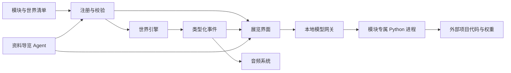

# 架构决策与边界

日期：2026-09-05。阶段：v0.1 基础版本。

## 需求判断

本项目的长期价值是能力、内容和经历的累积。空间表达应支持探索，核心不能依赖单个项目目录结构，也不能把所有模型环境合并进渲染进程。第一阶段以「进入世界 → 抵达展品 → 了解过程 → 输入并得到真实结果」为交付闭环。

用户明确要求占位资源优先，因此不等待个人摄影、音乐和 3D 模型。未名拾音按团队归属独立成区，个人音乐保留独立模块。

## 选择：Three.js + TypeScript + Electron + Python workers

| 方案 | 本项目适配性 | 决策 |
|---|---|---|
| Unity | 原生场景编辑、碰撞、动画和 Windows 发布成熟，但当前空工程且未发现安装的 Editor；仍需独立 Python 能力边界 | 若未来需要复杂地形、物理和专业美术生产线，可替换客户端 |
| Unreal | 高规格实时渲染能力强，工程和发布体量较大 | 当前阶段不采用 |
| Three.js + Electron | 同一份交互逻辑覆盖浏览器和 Windows；TypeScript 便于实现数据驱动模块与界面 | 本次采用 |

以上是针对当前目标的工程判断，不表示一个引擎普遍优于另一个。3D 渲染从 WebGL2 开始，避免把实验性的渲染后端变化引入第一阶段。Node 网关只执行本地受信任模块，PyTorch 仍留在独立环境。

官方依据：[Three.js WebGLRenderer](https://threejs.org/docs/pages/WebGLRenderer.html)、[Electron 进程模型](https://www.electronjs.org/docs/latest/tutorial/process-model)、[Electron 安全建议](https://www.electronjs.org/docs/latest/tutorial/security)。后续升级依赖时重新核对官方文档。

## 组件依赖

### World

区域清单产生岛屿和连接中央枢纽的步道。模块的区域与相对坐标决定展品位置。程序化建筑由 `visual` 选择预设；`visualAsset` 可覆盖为 GLB。玩家只走在岛屿和步道上，展品使用圆形阻挡体。当前不是完整物理引擎：无跳跃、刚体、复杂建筑室内碰撞和寻路网格。

资源由 World 统一释放：几何体、材质、纹理、动画、标签和事件监听器。GLB 加载失败保留占位。后续分区加载可在注册表与 World 之间加入 RegionLoader，不影响模型 API。

### Module / Data

注册表启动时扫描 `modules/*/manifest.json`，校验 `schemaVersion:1`、唯一 ID、已知区域、字段类型和静态资源路径。单模块错误会进入 warnings 并被隔离。世界主清单损坏则停止启动，避免带着错误拓扑继续运行。

模块的内容和接口是公开数据；模型绝对路径、解释器与 worker 路径只保存在后端。开发修改清单后重启；桌面分发更新 `resources/modules` 后重启。暂不承诺热装载或不可信第三方插件执行。

### Interaction / Exhibition

场景标签与索引触发 `select` 事件；靠近终端后 F 键触发 `interact`，打开产品工作台。UI 表单由 text / number / select / image 契约生成。模型输出作为纯文本显示，图片与作品来自显式资源路径。收藏仅保存模块 ID。

趣味装置读取区域的可选 `discovery` 配置。独立 Discoveries 类负责建模、距离判定、R 触发和动画，通过 `wonderNearby` / `discover` 事件连接提示与旅行印记；风铃通过 `melody` 事件进入现有交互音轨。面板/地图禁用触发，减少动态效果设置停用装饰动画。

### Model gateway

`GET /api/catalog` 暴露公开清单；`POST /api/modules/:id/invoke` 按该模块的 schema 校验数据，再启动其 worker。每个 worker 的工作目录为对应源项目，使用 `sys.path` 导入原模型实现。

运行层提供 180 秒超时、断开连接取消、输出上限和最多一个并发推理；忙时立即返回 429。逐次加载避免持久占用显存，是以加载时间换资源可预测性的初期选择。未来可替换为带空闲释放的常驻进程或 HTTP 服务，客户端契约不变。

安全边界为个人本机使用：只监听 127.0.0.1，限制 Host / Origin、JSON 请求和输入大小；不提供任意命令、路径或 EXE 启动接口。Python worker 是受信任的本地可执行代码，**进程隔离用于依赖和资源生命周期，不是恶意代码沙箱**。

### Agent

当前世界向导从展品标题、标签和事实中检索，明确标注资料导览。`data/world.json` 的 `agents[].chatModule` 指定真实聊天入口。XiangLM 原始权重没有被假定已记住项目资料。未来可加检索增强、上下文摘要和经过授权的工具调用；当前无自主外部行动。

### Audio

音轨分别控制 ambient / music / ui / interaction；区域音乐按 region ID 匹配。首次用户手势启用声音。缺少真实 UI / 交互文件时使用轻量合成提示，环境及背景音乐默认静音。v0.7 支持模块声明环境音与 1.2 秒交叉淡入淡出，静音和销毁会终止全部淡出音轨。尚未实现空间音频和混音台。

### Persistence / Desktop

存档 key 带版本号，容忍损坏或不可用的 localStorage。只保存访问、收藏、旅行印记、记忆碎片及声音偏好，不存图片或模型输入。Electron 使用固定端口 4319 维持稳定存储 origin，并通过单实例锁避免自身端口冲突。用户数据留在 Electron 默认 userData 目录。

沙箱和上下文隔离开启、Node 集成关闭，无通用 preload API。外链在系统浏览器打开，当前只允许指定的 MV 链接。摄像头只能由用户主动请求，关闭面板释放设备。

## 主要风险与后续决策

1. **CPU 冷启动成本**：XiangLM 原 checkpoint 约 2.4 GB，当前按请求加载。先记录实际时延，再决定常驻、量化或 CUDA 环境；不自动转换和覆盖原权重。
2. **模型表现与展览陈述不同**：表情分类不能当作心理测量；双盲诗没有语义主题控制；XiangLM 的生成内容不视为项目事实。
3. **长期模块增长**：本版所有区域同时加载，新增大量模型后应做分区加载、距离层级和资源预算。当前 API 不依赖这些渲染策略。
4. **原项目变更**：适配器依赖原 repo API，源码更新可能破坏兼容；升级后跑真实权重冒烟测试。未来以版本标签或明确模型发布契约管理。
5. **占位与科学真实性**：示意动画不用于科研结论，原始实验资料未自动发布。下一阶段选择可公开资料再整理进展品。
6. **分发**：便携 EXE 不等于包含所有 AI 的离线整包。需要独立配置 Python 和模型。签名、专用图标、安装器、自动更新待 Phase 4。

### v0.5 角色移动

`shared/locomotion.mjs` 独立处理水平移动、跳跃、重力和落地；`shared/navigation.mjs` 提供拓扑和可选高度碰撞。`src/world/colliders.ts` 按展示预设注册形状，低地台支持自动迈上，较高障碍需要跳跃。人物脚底高度加 1.7 米形成镜头位置。物理子步上限 1/120 秒，保持速度与碰撞不依赖渲染帧率；长卡顿仍按 100 毫秒限幅。

### v0.6 渲染与环境

第一人称相机由角色和 LookControls 独占，OrbitControls 使用单独地图相机。静态模型按区域与材质合批，动画、透明物体和 GLB 保留独立生命周期。Environment 管理日月、天空、海洋及一盏阴影光；区域灯带使用带 `nightGlow` 标记的共享发光材质，避免大量动态灯光。昼夜参数与纸蝶连续包络分别可用纯函数测试，详见 [v0.6 说明](releases/0.6.0/README.md)。

### v0.7 成长、记忆与源码扩展

`shared/memories.mjs` 从模块提取稳定记忆 ID 与星图位置；`shared/trail.mjs` 使用角色导航拓扑寻路，避免金色步道穿墙。`Memories` 负责可拾取标记、中心星图与目标提示，沿用 v1 本机存档并兼容旧数据。成长路线是概念策展顺序，不假定精确履历。

`PhotoCamera` 独立于步行和地图相机；摄影期间冻结世界动画增量和昼夜循环，退出恢复原角色与时间。PNG 从同步渲染的画布导出，排除 HTML 界面。`Signatures` 使用少量 Points 绘制分区氛围，无大量动态光源。

`World Module Contract v1` 为清单提供可选 world 扩展；模块自带 region.json 可增加区域，scene.ts / interactions.ts 通过 Vite 构建时发现。场景实例失败回退预设，动画失败只停用对应更新；模块静态资源经过真实路径边界检查。runtime 自动进入公开 tools 描述，conversation 模块自动注册聊天入口，原有模型隔离保持不变。详见 [完整契约](world-module-contract.md)。

### v0.8 统一地形表面

区域可选择 mountain 高度场与局部平坦台地。`terrain-height.mjs` 是唯一高度来源，导航拒绝低于地面的水平移动；角色的固定子步跟随缓坡，陡崖仍触发重力。建筑与局部碰撞统一加上标高，传送直接落在当前地面。山径与视觉捷径用原有障碍网格寻路，再以同一高度场绘制路面。

远方的量化交易所岛、机器人岛是独立建模预设，继续参与静态合批。Horizon 元数据驱动说明与摄影镜头；远眺借用独立 PhotoCamera，保留角色原位置，不制造尚未实现的模型能力或实时行情。
